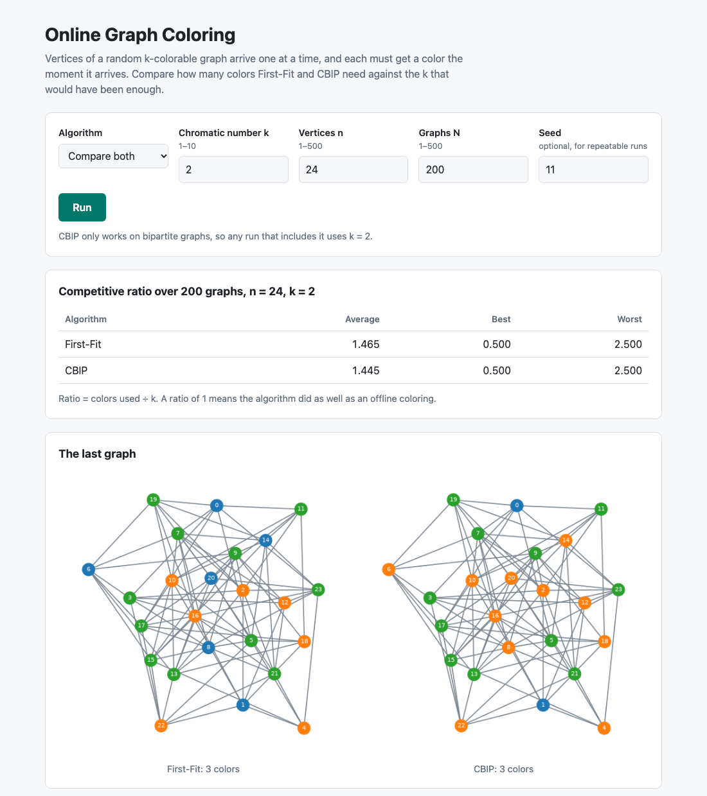
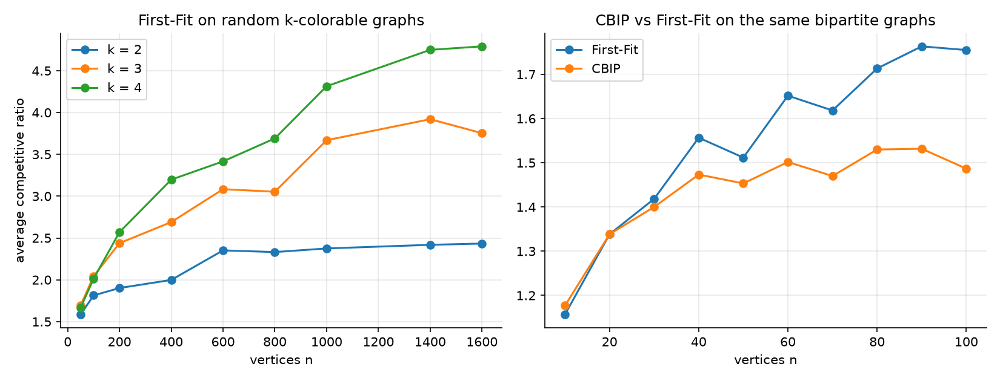

# Online Graph Coloring: First-Fit vs CBIP

[](https://github.com/rajatjc/GraphColoring/actions/workflows/ci.yml)

In **online** graph coloring the vertices arrive one at a time. When a vertex arrives you see only its
edges to vertices that came earlier, and you must give it a color right away and never change it. This
project measures how much that costs two classic algorithms: how many colors they use on random
k-colorable graphs, compared with the k colors an offline algorithm could get away with.

It has three parts: a small library (`coloring/`), a web app for trying single runs, and a study script
that reproduces the experiments.



## The algorithms

**First-Fit** gives each arriving vertex the smallest color not already used by one of its earlier
neighbours. It is simple and usually fine, but an adversary can make it use n/2 colors on a graph that
needs 2. The tests build that graph (K(m,m) minus a perfect matching, arriving a₀, b₀, a₁, b₁, …).

**CBIP** (Coloring Based on Interval Partitioning) works on bipartite graphs. When v arrives it splits
the component containing v (in the graph revealed so far) into its two sides, and gives v the smallest
color not used on the opposite side. That guarantees O(log n) colors on bipartite graphs. On the same
adversarial graph, the tests check it stays under 2·log₂ n. It is only defined for k = 2.

**The graphs.** `random_k_colorable(n, k)` puts vertex i in class i mod k and joins each pair of vertices
from different classes with probability p. A fresh p is drawn uniformly for each graph, as in the
original study. Vertices arrive in order 0, 1, 2, …

**The competitive ratio** reported for one graph is colors used ÷ k. The true chromatic number can be
below k (for example when p is small), so this is a lower bound on the real ratio.

## Results

From `python -m coloring.study --instances 300` (seed 2023). Each point averages 300 random graphs.



| First-Fit, average ratio | n = 50 | 100 | 200 | 400 | 800 | 1000 | 1600 |
|---|---|---|---|---|---|---|---|
| k = 2 | 1.59 | 1.81 | 1.90 | 2.00 | 2.33 | 2.38 | 2.43 |
| k = 3 | 1.69 | 2.04 | 2.44 | 2.69 | 3.05 | 3.67 | 3.75 |
| k = 4 | 1.67 | 2.01 | 2.57 | 3.20 | 3.69 | 4.31 | 4.79 |

On the same bipartite graphs (k = 2):

| n | 20 | 40 | 60 | 80 | 100 |
|---|---|---|---|---|---|
| First-Fit, average | 1.34 | 1.56 | 1.65 | 1.71 | 1.76 |
| CBIP, average | 1.34 | 1.47 | 1.50 | 1.53 | 1.49 |
| First-Fit, worst | 2.5 | 4.0 | 3.5 | 4.0 | 5.0 |
| CBIP, worst | 2.5 | 3.0 | 3.0 | 2.5 | 2.5 |

- First-Fit's ratio keeps growing with n, and faster for larger k.
- On small bipartite graphs the two are level. From about n = 40, CBIP needs fewer colors on average
  and has a much better worst case. At n = 100 it never used more than 5 colors, while First-Fit
  needed up to 10.
- The full numbers are in [`results/first_fit.csv`](results/first_fit.csv) and
  [`results/cbip.csv`](results/cbip.csv). The original notebooks are in `ipynb/`.

## Run it

Requires Python 3.12 or newer.

```bash
python -m venv .venv && source .venv/bin/activate
pip install -r requirements.txt

python app.py                                 # web app on http://127.0.0.1:5000
python -m coloring.study                      # rerun the study (100 graphs per point, a couple of minutes)
python -m coloring.study --instances 1000     # the original N = 1000 (about 20 minutes)
```

In the web app, pick First-Fit, CBIP or **Compare both**, which runs both algorithms on the same graphs
and draws the last graph twice in the same layout. Add a seed to repeat a run exactly. Inputs are capped
at k ≤ 10, n ≤ 500, N ≤ 500 and n × N ≤ 100,000 per request.

With Docker:

```bash
docker build -t graphcoloring . && docker run -p 8000:8000 graphcoloring
```

Using the library directly:

```python
import random
from coloring import random_k_colorable, first_fit, cbip, colors_used

graph = random_k_colorable(100, 2, rng=random.Random(1))
print(colors_used(first_fit(graph)), colors_used(cbip(graph)))
```

## Tests

```bash
pip install -r requirements-dev.txt
pytest
```

37 tests cover the algorithms (proper colorings on random graphs, the First-Fit lower bound, CBIP's
log bound and odd-cycle check, the generator's guarantees), the experiment runner, the study script and
the web app's validation and output. GitHub Actions runs them on Python 3.12 and 3.13, then builds the
Docker image and runs a comparison against it.

## Layout

```
coloring/
  graphs.py        random k-colorable graph generator
  algorithms.py    first_fit, cbip, is_proper
  experiment.py    run several algorithms on the same random graphs and summarise ratios
  study.py         the sweep behind results/
app.py             Flask app (templates/index.html)
tests/
results/           CSVs and chart from the study
ipynb/             the original notebooks
```

## References

1. Li, Y., Narayan, V. V., Pankratov, D. (2022). Online Coloring and a New Type of Adversary for Online
   Graph Problems. *Algorithmica* 84(4), 1232–1251.
2. Lovász, L., Saks, M., Trotter, W. T. (1989). An on-line graph coloring algorithm with sublinear
   performance ratio. *Discrete Mathematics* 75, 319–325.
3. Erdős, P., Rényi, A. (1959). On random graphs I. *Publicationes Mathematicae* 6, 290–297.
4. Kierstead, H., Smith, D., Trotter, W. (2015). First-fit coloring on interval graphs has performance
   ratio at least 5. *European Journal of Combinatorics* 51.
